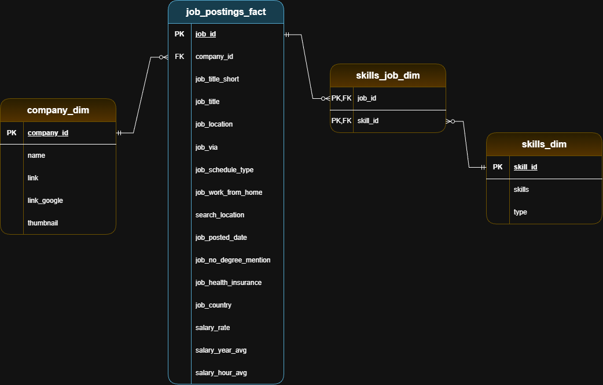
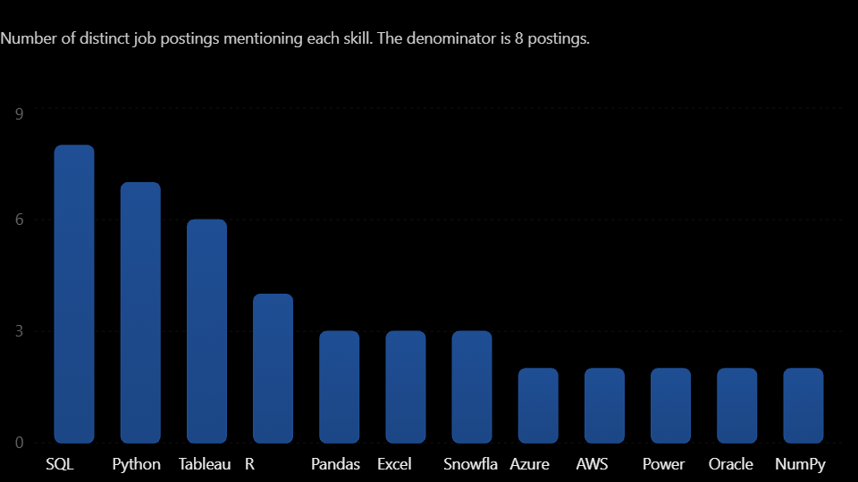

# Data Analyst Job Market Analysis (Dataset from 2023)

## 1. Introduction

This project explores the Data Analyst job market using SQL and PostgreSQL. The objective is to identify high-paying opportunities, understand the most in-demand skills, and discover which technical skills offer the best combination of demand and salary.

## 2. Background

The project uses job posting data from 2023, containing information about job titles, companies, locations, annual salaries and required technical skills.

By analyzing job postings and connecting job and skill-related tables, I investigated the relationship between technical skills, market demand and salary levels.

## 3. Tools & Technologies I Used

- **SQL:** Data exploration, filtering, aggregation, joins, CTEs, and sorting.
- **PostgreSQL:** Database management and execution of analytical queries.
- **VS Code:** SQL development environment using SQLTools.
- **Git & GitHub:** Version control and project documentation.

## 4. Data Model & Documentation

The database consists of four related tables organized using a dimensional modeling approach.

The data model illustrates the relationships between job postings, companies, and required skills, including the bridge table used to resolve the many-to-many relationship between job postings and skills.

### Data Model

### Data Catalog

For a detailed overview of the database structure, including table descriptions, column definitions, data types, primary keys, and foreign keys, see the [Data Catalog](assets/data_catalog.md).

## 5. Analysis

The project addresses five key business questions:

### 1) Top-Paying Data Analyst Jobs 
Identified the 10 highest-paying remote Data Analyst positions based on average annual salary.

| Job Title | Company | Average Annual Salary |
|---|---|---|
| Data Analyst | Mantys | $650,000 |
| Director of Analytics | Meta | $336,500 |
| Associate Director- Data Insights | AT&T | $255,829.50 |
| Data Analyst, Marketing | Pinterest Job Advertisements | $232,423 |
| Data Analyst (Hybrid/Remote) | UCLA Health Careers | $217,000 |
| Principal Data Analyst (Remote) | SmartAsset | $205,000 |
| Director, Data Analyst - HYBRID | Inclusively | $189,309 |
| Principal Data Analyst, AV Performance Analysis | Motional | $189,000 |
| Principal Data Analyst | SmartAsset | $186,000 |
| ERM Data Analyst | Get It Recruit - Information Technology | $184,000 |

### 2) Skills Required for Top-Paying Jobs 
Examined the technical skills associated with the highest-paying positions.

### 3) Most In-Demand Skills 
Identified the five most frequently requested skills across Data Analyst job postings.

| Skills | Demand Count | 
| --- | --- |
| sql | 92628 |
| excel | 67031 |
| python | 57326 | 
| tableau | 46554 |
| power bi | 39468 | 

### 4) Highest-Paying Skills 
Calculated average annual salaries associated with individual skills to identify their earning potential.

However, average salary alone does not necessarily indicate how valuable a skill is. Skills appearing in only a few job postings may have unusually high average salaries due to a small sample size.

To provide additional context, I included the number of job postings associated with each skill.

| Skills | Job Demand | Average Annual Salary |
| --- | --- | --- |
| sql | 3083 | 96545 |
| excel | 2143 | 86418 |
| python | 1840 | 101511 |
| tableau | 1659 | 97978 |
| r | 1659 | 98797 | 

*Note: Job posting counts in this analysis represent postings with reported annual salaries.*

### 5) Optimal Skills to Learn 
Combined skill demand and average salary to identify skills that offer a strong balance between market demand and financial opportunities.

The analysis focuses specifically on remote Data Analyst positions with reported annual salaries. Skills appearing in at least 10 job postings were considered to reduce the influence of small sample sizes.

This analysis helps identify technical skills that are both frequently requested and associated with competitive salaries.

## 6. What I Learned

Through this project, I strengthened my practical SQL skills and gained experience with:

- Complex queries using multiple table joins.
- Common Table Expressions (CTEs) for structuring analytical queries.
- Aggregate functions such as COUNT(), AVG() and ROUND().
- Filtering, grouping, sorting, and handling NULL values.
- Connecting job postings with related skills through relational database tables.
- Translating business questions into actionable SQL queries.
- Evaluating the relationship between technical skills, job demand, and salaries.

## 7. Conclusions

This project demonstrates how SQL can be used to transform raw job posting data into meaningful insights about the Data Analyst job market.

By examining salary levels, skill demand, and the relationship between the two, the analysis provides a data-driven perspective on which technical skills are valuable for aspiring Data Analysts.

The findings can help guide career development by highlighting skills that are frequently requested and associated with higher-paying opportunities.

**Note:** The findings reflect the available 2023 dataset and should not be interpreted as a representation of current job market conditions.

### Credits

Special thanks to [Luke Barousse](https://www.youtube.com/@LukeBarousse) for his excellent free SQL tutorial on YouTube, which provided the foundation and inspiration for this project.

This project was developed as a practical exercise to strengthen my SQL skills and apply data analysis techniques to real-world job market data.

-- Dodaj Data Catalog i Star Schemu